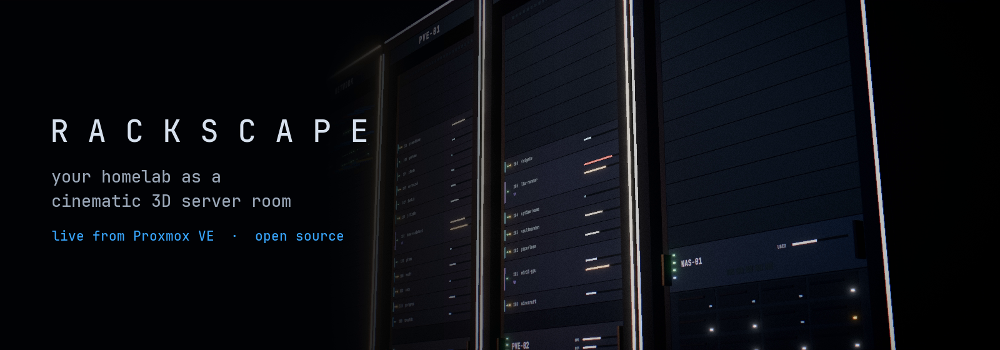
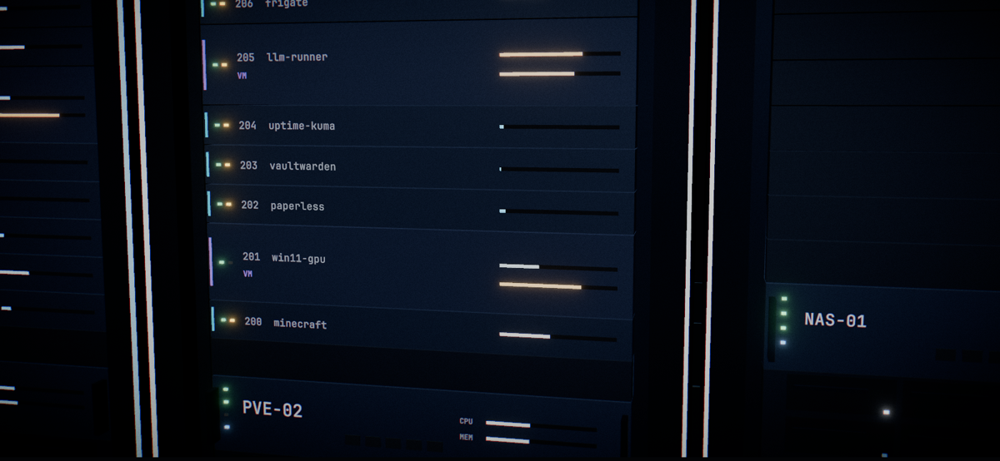
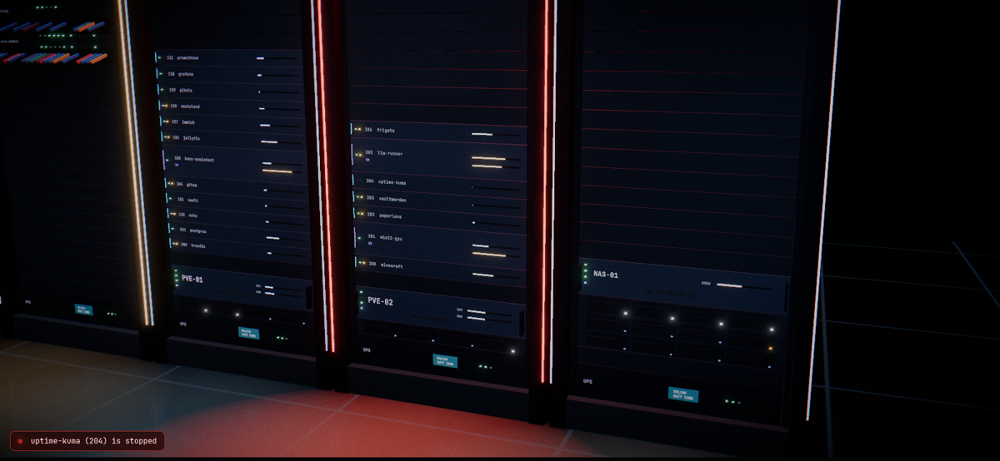
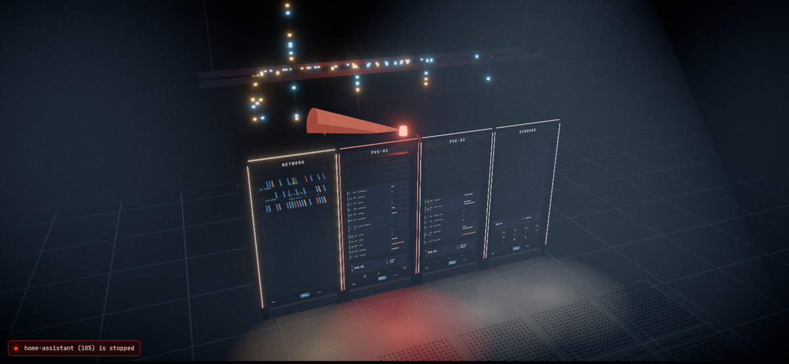
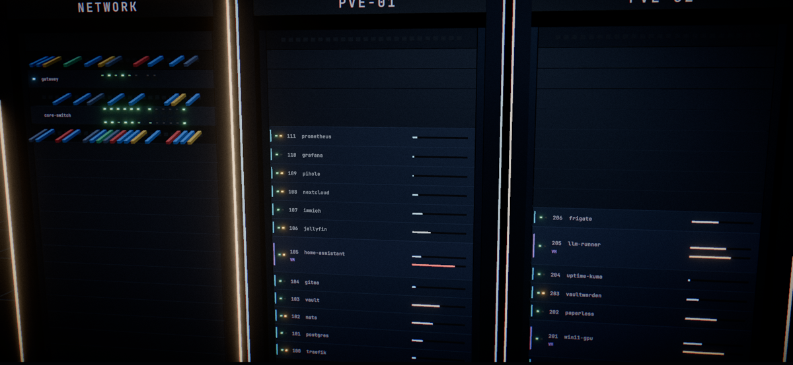

<div align="center">



# Rackscape

**Your homelab, as a cinematic 3D server room — live.**

Proxmox nodes become racks, every container and VM a rack unit with real LEDs.<br>
Traffic rides the cables, drive bays blink with I/O, and when something goes down<br>
a red beacon spins up and the camera cuts to it.

[](https://csiber.github.io/rackscape/)
[](https://github.com/csiber/rackscape/pkgs/container/rackscape)

[](https://github.com/csiber/rackscape/actions/workflows/ci.yml)
[](LICENSE)


</div>

## Why

Dashboards tell you numbers. Rackscape lets you *see* your lab: which box is busy, where the traffic flows, what just died. It is made to be left running — on a second monitor, a wall-mounted TV or the office tablet — and to be shown off.

- 🎬 **Cinematic autopilot** — dolly, slider, crane, push-in and overhead shots, cut together with a dip to black and a letterbox
- 🚨 **Alarm cut-ins** — a guest that should be running stops? Beacon on, camera on it
- 💡 **Everything is real data** — LEDs, load bars, cable packets and drive bays follow your cluster
- 📺 **TV mode** — no UI, endless flythrough, made for wall displays
- 🔒 **Read-only by design** — one `PVEAuditor` token, kept server-side; optional basic auth
- 🪶 **Tiny server** — a single Node file, no dependencies; Docker image for amd64 and arm64
- 🧩 **Embeddable** — drop it into your own dashboard and feed it data with `postMessage`

## Quick start

**Just look:** open the [live demo](https://csiber.github.io/rackscape/), which runs on a simulated homelab.

**Run it against your Proxmox** (read-only token, see [Proxmox setup](https://github.com/csiber/rackscape/wiki/Proxmox-setup)):

```sh
docker run -d --name rackscape -p 8080:8080 \
  -e PVE_URL=https://pve.lan:8006 \
  -e PVE_TOKEN='rackscape@pve!view=xxxxxxxx-xxxx-xxxx-xxxx-xxxxxxxxxxxx' \
  -e PVE_INSECURE=1 \
  ghcr.io/csiber/rackscape:latest
```

Open <http://localhost:8080>. Without `PVE_URL` it starts in demo mode.

<details>
<summary><b>Create the read-only token</b> (run on any Proxmox node)</summary>

```sh
pveum user add rackscape@pve --comment "Rackscape (read-only)"
pveum acl modify / --users rackscape@pve --roles PVEAuditor
pveum user token add rackscape@pve view --privsep 0
```

Copy the `value` it prints; that is the secret part of `PVE_TOKEN`.
</details>

<details>
<summary><b>Without Docker</b> (Node 18+)</summary>

```sh
git clone https://github.com/csiber/rackscape && cd rackscape
npm ci && npm run build
PVE_URL=https://pve.lan:8006 PVE_TOKEN='rackscape@pve!view=…' PVE_CA=/path/to/pve-root-ca.pem npm run server
```
</details>

## Screenshots

<table>
  <tr>
    <td></td>
    <td></td>
  </tr>
  <tr>
    <td></td>
    <td></td>
  </tr>
</table>

## What you see

| In the room | Comes from |
|---|---|
| A rack per node, one unit per container (1U) or VM (2U) | `/cluster/resources` |
| Power LED: green · dark · **blinking red** | running · stopped · stopped although `onboot=1` |
| Activity LED, glowing packets on the uplinks | network and disk I/O rates |
| Drive bays (amber = warning, red = failed) | SMART via `/nodes/<node>/disks/list` |
| Storage rack with capacity bars | shared storage: NFS, CIFS, PBS, Ceph… |
| Rack edge light: blue → amber with load, red on alarm | node CPU, alarms |

Rack height (24, 32 or 42U) adapts to your biggest node.

## Controls

| | |
|---|---|
| `C` | cinematic autopilot |
| `F` | free camera: drag to orbit, scroll to zoom |
| `T` | TV mode (also `?tv` in the URL) |
| click a rack | fly to it and show details |
| `Esc` | close details |

Touch the scene and you get the camera; leave it alone for 40 s and the autopilot takes over again.

## Documentation

The [wiki](https://github.com/csiber/rackscape/wiki) has the details:

- [Proxmox setup](https://github.com/csiber/rackscape/wiki/Proxmox-setup): token, certificates, permissions
- [Configuration](https://github.com/csiber/rackscape/wiki/Configuration): every environment variable and URL parameter
- [Docker & Compose](https://github.com/csiber/rackscape/wiki/Docker)
- [Wall display / TV mode](https://github.com/csiber/rackscape/wiki/Wall-display)
- [Embedding](https://github.com/csiber/rackscape/wiki/Embedding): put Rackscape inside your own app
- [Snapshot format](https://github.com/csiber/rackscape/wiki/Snapshot-format): write a data source for something else
- [Security](https://github.com/csiber/rackscape/wiki/Security) and [FAQ](https://github.com/csiber/rackscape/wiki/FAQ)

## Roadmap

- [x] Demo mode, Proxmox connector, cinematic camera, TV mode, embedding
- [ ] Network sources: UniFi, generic SNMP (real switch ports and WAN)
- [ ] Node temperatures and fan speeds
- [ ] Ambient sound: fan hum follows load
- [ ] Very large nodes: guests overflow into a second rack
- [ ] More sources: Docker hosts, Kubernetes nodes, TrueNAS

Ideas and screenshots of your own lab are welcome in [Discussions](https://github.com/csiber/rackscape/discussions).

## Contributing

PRs are welcome, see [CONTRIBUTING.md](CONTRIBUTING.md). `npm run dev` gives you the demo homelab with hot reload; no cluster needed.

## License

[MIT](LICENSE) © Csaba Polyák ([PromNET](https://promnet.hu)) · Font: JetBrains Mono (SIL OFL 1.1)
